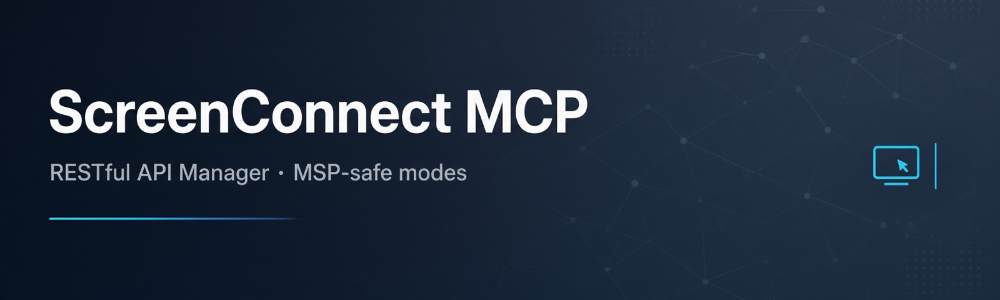
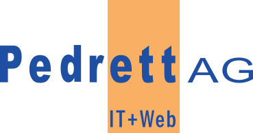

<p align="center">
  
</p>

<p align="center">
  
</p>

<h1 align="center">ScreenConnect MCP Server</h1>

<p align="center">
  <strong>MCP-Server für ConnectWise ScreenConnect</strong><br/>
  Sessions · Notizen · Nachrichten · Befehle — MSP-sichere Modi read / write / destructive
</p>

<p align="center">
  <a href="README.md">English</a> · <a href="README.de.md">Deutsch</a>
</p>

Inoffizielles Community-Projekt; nicht mit ConnectWise verbunden oder von ConnectWise unterstützt.

## Überblick

Der Server verbindet KI-Assistenten (ChatGPT, Claude, Gemini, …) mit einer ScreenConnect-Instanz über die Extension **RESTful API Manager**. Sicherheitsgrenzen sind **im Code** erzwungen: Standard ist read-only; Write- und Destructive-Tools nur mit explizitem Opt-in.

Stack wie beim [ALSO Cloud Marketplace MCP](https://github.com/pitwch/also-cloud-marketplace-mcp): TypeScript, Node.js 20+, `@modelcontextprotocol/server`, MIT.

## Extension & Secret einrichten

**Hier starten, wenn ihr noch kein REST-Secret habt.**

Schritt-für-Schritt (Extension installieren → `RESTfulAuthenticationSecret` setzen → curl-Test → MCP-Env):

- [docs/extension-setup.de.md](docs/extension-setup.de.md) (Deutsch)
- [docs/extension-setup.md](docs/extension-setup.md) (English)

Kurzfassung:

1. **Administration → Extensions** → **RESTful API Manager** (ConnectWise Labs) installieren.
2. **⋮ → Edit Settings** → `RESTfulAuthenticationSecret` setzen (langer Zufallswert). Das ist `SCREENCONNECT_API_SECRET` / Header `CTRLAuthHeader`.
3. Optional `RESTfulAllowedOrigin` → `SCREENCONNECT_ORIGIN`.
4. Mit curl `GetSessionsByFilter` prüfen, danach MCP mit `SCREENCONNECT_MODE=read` starten.

## Schnellstart

```bash
git clone https://github.com/pitwch/screenconnect-mcp-server.git
cd screenconnect-mcp-server
npm install
npm run build
```

Credentials setzen und im MCP-Client registrieren (`node <REPO>/dist/index.js`).

## Konfiguration

| Variable | Pflicht | Default | Zweck |
|----------|---------|---------|-------|
| `SCREENCONNECT_BASE_URL` | ja | — | HTTPS-URL der Instanz |
| `SCREENCONNECT_API_SECRET` | ja | — | `RESTfulAuthenticationSecret` (`CTRLAuthHeader`) |
| `SCREENCONNECT_MODE` | nein | `read` | `read` · `write` · `destructive` |
| `SCREENCONNECT_ENABLE_COMMANDS` | nein | `false` | Pflicht für Destructive-Tools |
| `SCREENCONNECT_ALLOWED_GROUPS` | nein | leer | Volle Session-Gruppenpfade |

Details: [docs/security-model.md](docs/security-model.md), [`.env.example`](.env.example).

## Tools

- **Read:** `health_check`, `list_sessions`, `search_sessions`, `get_session_details`, `get_session_events`, `get_server_info`
- **Write:** `add_session_note`, `send_message_to_session`, `update_session_name`, `update_custom_properties`
- **Destructive:** `send_command_to_session`, `send_toolbox_item`, `create_session` (jeweils `confirm: true`)

## Clients / mcpproxy

Beispiele: [docs/mcpproxy.example.yaml](docs/mcpproxy.example.yaml), [docs/mcp-client.example.json](docs/mcp-client.example.json) (ChatGPT, Claude, Gemini, …).  
Für Produktion: **stdio**, zuerst nur lesend freigeben. HTTP-Transport ist ein Stub (Tool-Calls → 501).

## Lizenz

MIT — [`LICENSE`](LICENSE).

<p align="center">
  <a href="https://www.pitw.ch">
    
  </a>
</p>

<p align="center">
  <strong>Pedrett IT+Web AG</strong> · <a href="https://www.pitw.ch">www.pitw.ch</a>
</p>
