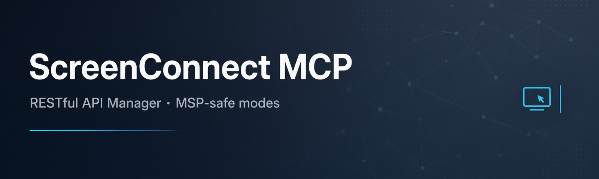
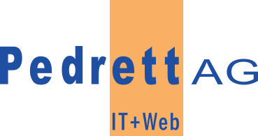

<p align="center">
  
</p>

<p align="center">
  
</p>

<h1 align="center">ScreenConnect MCP Server</h1>

<p align="center">
  <strong>MCP server for ConnectWise ScreenConnect</strong><br/>
  Sessions · Notes · Messages · Commands — MSP-safe read / write / destructive modes
</p>

<p align="center">
  <a href="README.md">English</a> · <a href="README.de.md">Deutsch</a>
</p>

<p align="center">
  <a href="https://www.npmjs.com/package/screenconnect-mcp-server"></a>
  <a href="https://registry.modelcontextprotocol.io/v0.1/servers/io.github.pitwch%2Fscreenconnect-mcp-server/versions/latest"></a>
  <a href="https://modelcontextprotocol.io"></a>
  <a href="LICENSE"></a>
  <a href="https://nodejs.org"></a>
  <a href="https://www.pitw.ch"></a>
</p>

Unofficial community project; not affiliated with or endorsed by ConnectWise.

---

## Overview

This server connects AI assistants (ChatGPT, Claude, Gemini, …) to a ScreenConnect instance via the **RESTful API Manager** extension. Security boundaries are enforced **in code**: default read-only mode, optional write tools with `dryRun` previews, and destructive command/toolbox tools only with explicit opt-in.

| | |
|---|---|
| **Protocol** | [Model Context Protocol](https://modelcontextprotocol.io) (`stdio` and single-tenant Streamable HTTP `/mcp`) |
| **API** | ConnectWise Labs RESTful API Manager |
| **Distribution** | npm (`npx -y screenconnect-mcp-server`) · [Official MCP Registry](https://registry.modelcontextprotocol.io) · Claude Desktop `.mcpb` · Docker |
| **Stack** | TypeScript · Node.js 20+ · `@modelcontextprotocol/server` |
| **License** | MIT |

### Why this server?

- **Standalone token auth — no admin passwords, no vendor lock-in:** Authenticates directly against your ScreenConnect instance using the official ConnectWise Labs **RESTful API Manager** shared secret (`CTRLAuthHeader`). No ScreenConnect admin username/password Basic Auth and no third-party SaaS broker.
- **Code-enforced 3-tier safety:** `SCREENCONNECT_MODE=read|write|destructive` hides disabled tools from `tools/list` and enforces gates in code. Write tools support `dryRun: true`; destructive tools require `SCREENCONNECT_ENABLE_COMMANDS=true`, `confirm: true`, and support an optional `expectedName` target guard.
- **MSP-ready hardening:** Session-group allowlist, HTTPS-only upstream validation, 10 MiB upstream response cap (`SCREENCONNECT_MAX_RESPONSE_BYTES`), secret-free stderr audit log, and Sigstore-attested npm releases published via GitHub Actions OIDC.

---

## Table of contents

- [Quick start](#quick-start)
- [ScreenConnect extension setup](#screenconnect-extension-setup)
- [Configuration](#configuration)
- [Tools](#tools)
- [Client setup](#client-setup)
- [Streamable HTTP & Docker](#streamable-http--docker)
- [Development](#development)
- [Links](#links)
- [License & provider](#license--provider)

---

## Quick start

### Option 1: `npx` (recommended for most MCP clients)

No clone or build required — add this to your MCP client config:

```json
{
  "mcpServers": {
    "screenconnect": {
      "command": "npx",
      "args": ["-y", "screenconnect-mcp-server"],
      "env": {
        "SCREENCONNECT_BASE_URL": "https://your-instance.example.com",
        "SCREENCONNECT_API_SECRET": "your-restful-api-manager-secret",
        "SCREENCONNECT_MODE": "read"
      }
    }
  }
}
```

### Option 2: Claude Desktop one-click bundle (`.mcpb`)

1. Download `screenconnect-mcp-server-vX.Y.Z.mcpb` from [GitHub Releases](https://github.com/pitwch/screenconnect-mcp-server/releases).
2. Double-click the `.mcpb` file to open it in **Claude Desktop**.
3. Enter your **ScreenConnect Base URL** and **RESTful API Manager Secret** (stored securely as a sensitive field), keeping **Safety Mode** on `read` to start.

### Option 3: Streamable HTTP server (remote / Docker / `mcpproxy`)

```bash
export SCREENCONNECT_BASE_URL="https://your-instance.example.com"
export SCREENCONNECT_API_SECRET="your-restful-api-manager-secret"
export SCREENCONNECT_MODE="read"
export MCP_TRANSPORT="http"
export MCP_HTTP_BEARER_TOKEN="$(openssl rand -hex 32)" # >= 32 chars

npx -y screenconnect-mcp-server
```

Serves MCP Streamable HTTP on `http://127.0.0.1:8080/mcp` (Bearer-protected with Host/Origin validation) and unauthenticated `GET /health`.

---

## ScreenConnect extension setup

**Start here if you do not have a REST secret yet.**

Full tutorial (install extension → create `RESTfulAuthenticationSecret` → curl probe → MCP env):

- English: [docs/extension-setup.md](docs/extension-setup.md)
- Deutsch: [docs/extension-setup.de.md](docs/extension-setup.de.md)

Short version:

1. **Administration → Extensions** → install **RESTful API Manager** (ConnectWise Labs).
2. **⋮ → Edit Settings** → set `RESTfulAuthenticationSecret` (long random secret / GUID). That value is `SCREENCONNECT_API_SECRET` and is sent as `CTRLAuthHeader`.
3. Optional: set `RESTfulAllowedOrigin` and mirror it as `SCREENCONNECT_ORIGIN`.
4. Probe with curl (`GetSessionsByFilter`), then start this server with `SCREENCONNECT_MODE=read`.

---

## Configuration

| Variable | Required | Default | Purpose |
|----------|----------|---------|---------|
| `SCREENCONNECT_BASE_URL` | yes | — | Instance HTTPS URL (`http://` is rejected) |
| `SCREENCONNECT_API_SECRET` | yes | — | Extension `RESTfulAuthenticationSecret` (`CTRLAuthHeader`) |
| `SCREENCONNECT_EXTENSION_ID` | no | `2d558935-686a-4bd0-9991-07539f5fe749` | Extension GUID |
| `SCREENCONNECT_ORIGIN` | no | — | Must match `RESTfulAllowedOrigin` when set |
| `SCREENCONNECT_ALLOWED_GROUPS` | no | empty | Full session-group paths (comma-separated) |
| `SCREENCONNECT_MODE` | no | `read` | `read` · `write` · `destructive` |
| `SCREENCONNECT_ENABLE_COMMANDS` | no | `false` | Required for destructive tools |
| `SCREENCONNECT_TIMEOUT_MS` | no | `30000` | Per-call timeout (ms, max 120000) |
| `SCREENCONNECT_MAX_RESPONSE_BYTES` | no | `10485760` | Upstream response cap (10 MiB default, max 50 MiB) |
| `MCP_TRANSPORT` | no | `stdio` | `stdio` (default) or `http` (Streamable HTTP on `/mcp`) |
| `MCP_HTTP_HOST` | no | `127.0.0.1` | Bind address when `MCP_TRANSPORT=http` |
| `MCP_HTTP_PORT` | no | `8080` | Bind port when `MCP_TRANSPORT=http` |
| `MCP_HTTP_BEARER_TOKEN` | http only | — | Bearer token for `/mcp` (**minimum 32 characters**) |
| `MCP_HTTP_ALLOWED_ORIGINS` | no | localhost | Allowed `Origin` headers / hostnames for `/mcp` |

See [`.env.example`](.env.example) and [docs/security-model.md](docs/security-model.md).

---

## Tools

### Read (`SCREENCONNECT_MODE=read`)

| Tool | Purpose |
|------|---------|
| `health_check` | Reachability + auth probe |
| `list_sessions` / `search_sessions` | `GetSessionsByFilter` (structured fields incl. `onlineOnly` / `offlineOnly`, or raw filter) |
| `get_session` | Lightweight single-session lookup (`GetSessionBySessionID`, allowlist-checked) |
| `get_session_details` | OS, user, IP, custom properties, online state (optional redacted `includeRaw`) |
| `get_session_events` | Events from session details with readable `eventTypeName` |
| `get_server_info` | Local mode/allowlist metadata (no upstream call) |

### Write (`MODE=write`, all support `dryRun: true`)

| Tool | Purpose |
|------|---------|
| `add_session_note` | Append note (`dryRun: true` previews target & note) |
| `send_message_to_session` | Guest message (`dryRun: true` previews message) |
| `update_session_name` | Rename session (`dryRun: true` shows current → new name) |
| `update_custom_properties` | Merge slots 1–8 (`dryRun: true` previews merged 8-slot array) |

### Destructive (`MODE=destructive` + `ENABLE_COMMANDS=true` + `confirm: true`)

| Tool | Purpose |
|------|---------|
| `send_command_to_session` | Queue cmd/PowerShell; optional `expectedName` guard & output poll |
| `send_toolbox_item` | Run toolbox item; optional `expectedName` guard |
| `create_session` | Create Support/Meeting/Access session |

---

## Client setup

<details>
<summary><strong>ChatGPT / Claude / Gemini</strong></summary>

Most MCP clients use a JSON `mcpServers` block. Start from [docs/mcp-client.example.json](docs/mcp-client.example.json) using `npx -y screenconnect-mcp-server`, or install the `.mcpb` bundle directly in Claude Desktop.

</details>

<details>
<summary><strong>mcpproxy</strong></summary>

See [docs/mcpproxy.example.yaml](docs/mcpproxy.example.yaml) for both `stdio` (recommended default) and Streamable HTTP examples. Start with read mode before enabling write/destructive.

</details>

---

## Streamable HTTP & Docker

### Docker (stdio)

```bash
docker build -t screenconnect-mcp-server .
docker run --rm -i \
  -e SCREENCONNECT_BASE_URL=https://your-instance.example.com \
  -e SCREENCONNECT_API_SECRET=... \
  -e SCREENCONNECT_MODE=read \
  screenconnect-mcp-server
```

### Docker (Streamable HTTP)

```bash
docker run --rm -p 127.0.0.1:8080:8080 \
  -e SCREENCONNECT_BASE_URL=https://your-instance.example.com \
  -e SCREENCONNECT_API_SECRET=... \
  -e SCREENCONNECT_MODE=read \
  -e MCP_TRANSPORT=http \
  -e MCP_HTTP_HOST=0.0.0.0 \
  -e MCP_HTTP_PORT=8080 \
  -e MCP_HTTP_BEARER_TOKEN="$(openssl rand -hex 32)" \
  screenconnect-mcp-server
```

Runs as non-root. Bind to loopback (`127.0.0.1`) or place behind a TLS-terminating reverse proxy — never expose `/mcp` directly over plain HTTP on the public internet.

---

## Development

```bash
git clone https://github.com/pitwch/screenconnect-mcp-server.git
cd screenconnect-mcp-server
npm install
npm run typecheck
npm run lint
npm test
npm run build
npm run smoke
npm run build:mcpb
```

Live fixture capture (lab instance only): `npm run capture-fixtures`  
(`*.live.json` is gitignored.)

**Important:** write only MCP JSON-RPC to stdout — log exclusively with `console.error`.

### Releasing

Each `package.json` version gets a GitHub Release (`vX.Y.Z`) with notes from [`CHANGELOG.md`](CHANGELOG.md) and the built `screenconnect-mcp-server-vX.Y.Z.mcpb` bundle attached.

```bash
# 1. Bump version in package.json, server.json, src/version.ts, CHANGELOG.md, commit to main
# 2. Tag and push — CI publishes the GitHub Release (.mcpb), npm package, and MCP Registry entry automatically
git tag -a v0.2.0 -m "v0.2.0"
git push origin v0.2.0
```

Releases: https://github.com/pitwch/screenconnect-mcp-server/releases

The `publish-mcp.yml` workflow publishes the npm package (Trusted Publishing with Sigstore provenance) and then `server.json` to the [official MCP Registry](https://registry.modelcontextprotocol.io) (`io.github.pitwch/screenconnect-mcp-server`) using GitHub Actions OIDC — no long-lived tokens required.

---

## Links

| Resource | URL |
|----------|-----|
| npm package | https://www.npmjs.com/package/screenconnect-mcp-server |
| Official MCP Registry | https://registry.modelcontextprotocol.io/v0.1/servers/io.github.pitwch%2Fscreenconnect-mcp-server/versions/latest |
| Repository | https://github.com/pitwch/screenconnect-mcp-server |
| Extension setup | [docs/extension-setup.md](docs/extension-setup.md) |
| ALSO Cloud MCP (sibling) | https://github.com/pitwch/also-cloud-marketplace-mcp |
| MCP Spec | https://modelcontextprotocol.io |
| Provider | https://www.pitw.ch |
| Social preview | [`docs/assets/social-preview.png`](docs/assets/social-preview.png) (1280×640 — GitHub → Settings → General → Social preview) |

---

## License & provider

MIT License — see [`LICENSE`](LICENSE).

<br/>

<p align="center">
  <a href="https://www.pitw.ch">
    
  </a>
</p>

<p align="center">
  <strong>Developed and provided by</strong><br/>
  <a href="https://www.pitw.ch"><strong>Pedrett IT+Web AG</strong></a><br/>
  <a href="https://www.pitw.ch">www.pitw.ch</a>
</p>

<p align="center">
  <em>Full automation and support — directly from the developer.</em>
</p>

<p align="center">
  <sub>Murgtalstrasse 20 · 9542 Münchwilen TG · Switzerland · <a href="mailto:info@pitw.ch">info@pitw.ch</a></sub>
</p>
